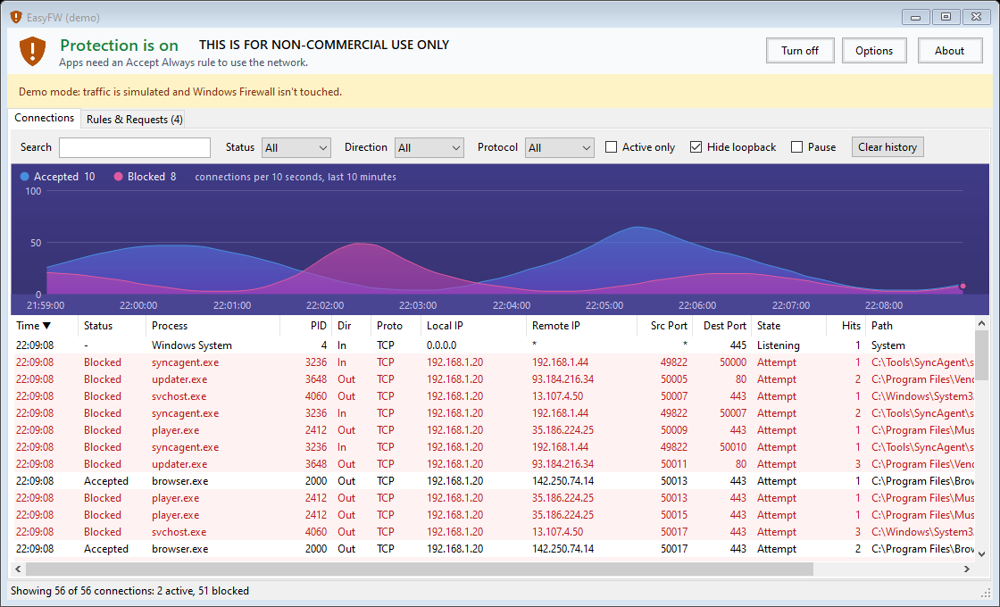
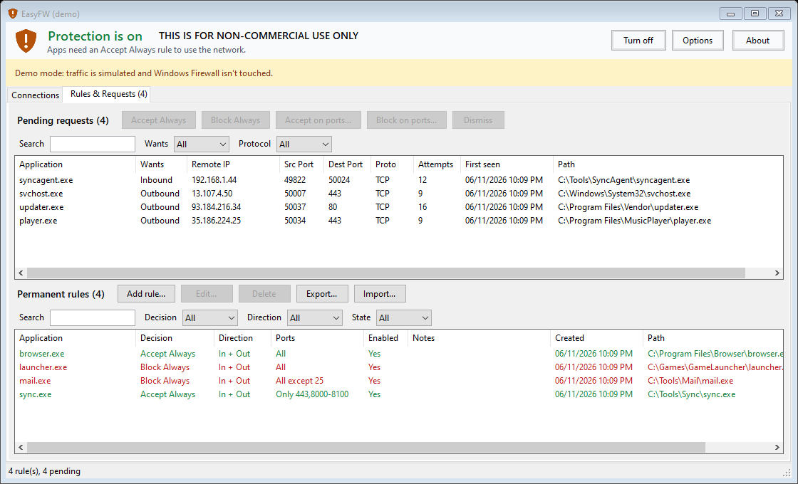
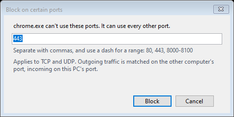

<div align="center">

# 🛡️ EasyFW

**A simple opt-in firewall for Windows.**
Nothing reaches the network until you approve it.




</div>

## Why EasyFW?

By default, Windows lets almost any program connect out to the internet. EasyFW turns that around: every app is blocked until you decide. When a new app tries to connect, it appears in a list and you choose whether to accept or block it.

EasyFW doesn't add its own filtering engine or kernel driver. It sets up **Windows Firewall** for you, so the Windows services `MpsSvc` and `BFE` do the blocking.

## Features

- **Blocks by default:** incoming and outgoing traffic is blocked for every app without a rule. Essential DNS and DHCP stay allowed.
- **Requests you can act on:** each new app shows up once, with its remote IP, ports and protocol.
- **Rules per app:** accept or block an app on all ports, or only on the ones you list, such as `80, 443, 8000-8100`.
- **Live connections:** a sortable, filterable list of active and attempted connections, marked accepted or blocked.
- **Traffic graph:** accepted and blocked connections per 10 seconds, over the last 10 minutes.
- **Tamper check:** once a minute, EasyFW switches off new allow rules added by installers and re-applies the block defaults if something changed them.
- **Export and import:** save your rules to a JSON file and load them on another PC.
- **Copy rows:** right-click any connection or pending request to copy it, ready to paste into a spreadsheet.
- **Tray icon:** shows status and pending requests, and gives quick access to the main controls.
- **Clean exit:** exiting EasyFW puts Windows Firewall back the way it was.

| Decide what each app can do | Limit a decision to certain ports |
|---|---|
|  |  |

## Before you run it

> [!WARNING]
> **EasyFW blocks everything as soon as it starts**, including your browser and remote access tools such as RDP, VNC and TeamViewer. If you manage the PC remotely, you can lock yourself out. Approve those tools first, or use a PC you can reach in person.

> [!TIP]
> **Try it safely first:** `EasyFW.exe --demo` uses simulated traffic and never touches Windows Firewall.

If you lose network access and the app won't help, exit EasyFW and run `EasyFW.exe --restore`.

## Getting started

You need Windows, the [.NET SDK](https://dotnet.microsoft.com/download) and the [.NET Framework 4.8 Developer Pack](https://dotnet.microsoft.com/download/dotnet-framework/net48).

```
git clone https://github.com/ahmedosama80/EasyFW.git
cd EasyFW
dotnet build EasyFW.sln -c Release
src\EasyFW\bin\Release\EasyFW.exe --demo
```

Every launch asks for administrator rights, including `--demo`. To debug from VS Code, run VS Code as administrator.

| Command | What it does |
|---|---|
| `EasyFW.exe` | Normal use. **Blocks everything straight away**, then runs setup on first launch. |
| `EasyFW.exe --demo` | Simulated traffic. Never touches Windows Firewall. |
| `EasyFW.exe --monitor-only` | Shows real active connections. Changes nothing and can't block anything. |
| `EasyFW.exe --restore` | **Recovery.** Puts Windows Firewall back as it was, then exits. |
| `EasyFW.exe --tray` | Starts hidden in the tray. Used by Start at logon. |

Closing the window only hides EasyFW to the tray, and protection stays on. To stop protection, use **Exit** from the tray menu.

## How it works

| Need | Source |
|---|---|
| Enforcement | Windows Firewall, through the `HNetCfg` COM API |
| Attempted connections | Security log events 5156 and 5157, watched live |
| Active connections | `GetExtendedTcpTable` and `GetExtendedUdpTable`, polled every second |

<details>
<summary><b>What happens when protection turns on</b></summary>

1. Saves the current default policy and audit setting to disk.
2. Records all existing allow rules, then switches them off. Left on, they would let apps bypass the opt-in.
3. Adds the essential-networking rules and your app rules.
4. Sets inbound and outbound defaults to block on all profiles.
5. Turns on the Filtering Platform Connection audit, which produces the log events.
6. Closes open connections the rules don't allow, and keeps doing so every second.

If any step fails, the changes are rolled back.

Windows commits each rule change separately, about 8 a second, so turning protection on or off takes around two minutes on a PC with 900 allow rules. The window shows progress, and EasyFW won't exit until it finishes. If it's killed part-way:

- **While turning on:** the next launch finishes turning it on.
- **While turning off:** the next launch turns it back on. Use `--restore` to finish turning it off.

Protection always comes on when EasyFW starts, so turning it off lasts until the next launch.

Turning protection off reverses all of this using the saved state. It does not turn Windows Firewall off. If Windows shuts down or the process is killed while protection is on, Windows Firewall stays blocking until EasyFW next starts and exits, or until you run `--restore`.

</details>

<details>
<summary><b>How port rules and columns work</b></summary>

- **Accept on ports** lets the app use only the ports you list.
- **Block on ports** stops only those ports and lets the app use all others, because a plain block adds nothing when everything is already blocked.
- Rules cover TCP and UDP. Outgoing traffic is matched on the remote port and incoming on the local port. Ping rules have no ports.
- **Src Port** belongs to whoever started the connection, so on an incoming connection it's the other computer's port. Rules match **Dest Port**.
- **Status** says Accepted only for a connection that completed. Sockets that are listening, bound or still connecting show `-`, because the firewall hasn't ruled on them.

</details>

<details>
<summary><b>Where settings are stored</b></summary>

Config is in `%ProgramData%\EasyFW\config.json`. That folder is writable only by administrators, because a program that could edit the file could approve itself.

Import adds to your rules, and a rule for an app you already have a rule for replaces it. Only rules move, never protection state or the saved Windows Firewall settings.

EasyFW used to be called HomeFW. Exit any old copy first, or EasyFW won't start. On its first start EasyFW moves `%ProgramData%\HomeFW`, takes over the old firewall rules and moves the logon task.

</details>

## Known limits

- **It can't stop a program running as administrator.** Such a program can change the firewall directly. The one-minute check reduces this but doesn't prevent it.
- **Approval is per program file, not per service.** Accepting `svchost.exe` opens every service hosted in it, and the app warns you about that. The essential rules are narrower, limited to specific services and ports.
- **Loopback traffic isn't filtered,** because Windows Firewall doesn't filter it.
- **Some open connections can't be closed.** Windows Firewall only judges new connections, so EasyFW closes open ones itself. This covers IPv4 TCP only: IPv6 connections and UDP traffic can carry on until they end. Connections whose program can't be identified are left alone.
- **Ping can't be approved per app.** Windows logs pings under System, so blocked pings appear as their own **Ping (ICMP)** request, and accepting it lets every app ping.
- **Essential DNS is allowed for every app,** since it goes through the Windows DNS service. A blocked app can still cause name lookups.
- **Other firewalls and policies can interfere.** EasyFW refuses to turn on if Group Policy controls Windows Firewall. A security suite with its own firewall may take over from Windows Firewall, and then EasyFW's rules don't apply.
- **The Security log gets busier.** Event 5156 fires for every allowed connection, so older entries roll off sooner. The previous audit setting comes back when protection is turned off. If the setting's text can't be read, for example on a non-English Windows, it's left as is.
- **Start at logon runs the exe elevated with no prompt.** Install it under Program Files first, or another program could replace the file. The app warns you if you don't.

## Project status

EasyFW is early software. Its logic is covered by automated tests against a fake firewall, but real-world use so far is limited to a single PC, and not every feature has been exercised there. Try `--demo` first, and know how to use `--restore`.

## Development

```
dotnet run --project tests/EasyFW.Tests                  # logic tests against a fake firewall
dotnet run --project tests/EasyFW.Tests -- --probe       # real Windows APIs; writes are refused when not elevated
dotnet run --project tests/EasyFW.Tests -- --shots shots # renders each screen to PNG in demo mode
```

`--probe` reads the real firewall policy and rules. When not elevated, it also tries to write the current values back, to confirm Windows refuses. It skips that write when elevated.

| Folder | Contents |
|---|---|
| `src/EasyFW/Core` | Rules, pending requests, connection history, config |
| `src/EasyFW/Platform` | Windows Firewall COM, audit policy, event log, connection tables, logon task |
| `src/EasyFW/UI` | Tray, main window, tabs, setup wizard |
| `src/EasyFW/Demo` | The no-op backend and simulated traffic behind `--demo` |
| `tests/EasyFW.Tests` | Logic tests, the real-API probe and the screenshot renderer |

The original request is in [docs/SPEC.md](docs/SPEC.md).

## License

**This software is for non-commercial use only.**

Developed by **Ahmed Osama Mohamed**. For a commercial license, contact [ahmed_osama@hotmail.com](mailto:ahmed_osama@hotmail.com).
